<div align="center">

# Riyadh 360 · الرياض 360

**A 3D Riyadh in the browser, built from real OpenStreetMap data · الرياض ثلاثية الأبعاد في المتصفح من بيانات الخريطة المفتوحة**

[](https://aymn74.github.io/slop-riyadh/)

  -7ebc6f?logo=openstreetmap)   [](https://github.com/Aymn74/slop-riyadh/actions/workflows/test.yml) 

<a href="https://aymn74.github.io/slop-riyadh/">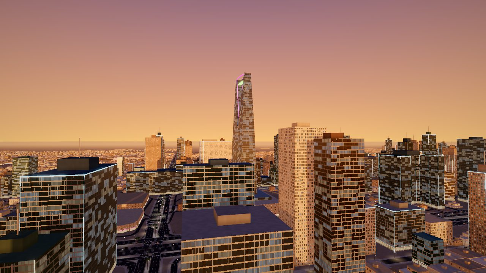</a>

<sub>Kingdom Centre and the towers of Olaya at maghrib · برج المملكة وأبراج العليا وقت المغرب</sub>

[العربية](#بالعربية) · [English](#in-english) · [Screenshots](#screenshots) · [Controls](#controls) · [Data](#data) · [Files](#files) · [Tests](#tests)

</div>

Inspired by [mrdoob/slop-newyork](https://github.com/mrdoob/slop-newyork). It works on phones and computers.

<div dir="rtl">

## بالعربية

**الرياض 360**: مدينة الرياض ثلاثية الأبعاد في المتصفح، مبنية من بيانات الخريطة المفتوحة الحقيقية: شوارعها ومبانيها وحدائقها وأنفاقها وجسورها. تجوّل فيها مشياً، أو بسيارة لاندكروزر، أو بطائرة هليكوبتر، أو دع الجولة السياحية تأخذك.

### الاستكشاف
- **ثلاث طرق للتنقل:** المشي، والقيادة، والطيران، في شوارع الرياض الحقيقية من طريق الملك فهد والعليا إلى الديرة والدرعية.
- **أنفاق وجسور:** الطرق تنزل في الأنفاق وترتفع على الجسور كما في الواقع. داخل النفق جدران مكسوة بشريط أزرق، وصفّان متصلان من المصابيح، وممشى بحافة صفراء وسوداء، وأضواء إرشاد، ولوحات طوارئ ومراوح تهوية؛ ويخفت ضوء النهار وتتكيف العين فيبهر ضوء المخرج.
- **الرياض القديمة بالطراز النجدي:** المصمك، وجامع الإمام تركي بمئذنتيه وجسوره إلى قصر الحكم، وسوق الزل، وقصر المربع، والقصر الأحمر، والمتحف الوطني، ومكتبة الملك فهد، مبنية على مخططاتها الحقيقية بجدران الطين والحجر والشرفات المثلثة، ومضاءة ليلاً.
- **أربعة أوقات:** الظهيرة، والمغرب، والليل بإضاءة الشوارع والمباني، والهبوب (عاصفة رملية).
- **حركة مرور** تسير على شبكة الطرق الفعلية وتلتزم بحدود السرعة.
- **على الجوال:** مقود حقيقي تديره بإصبعك حتى 150° في كل اتجاه ويعود إلى المنتصف عند تركه، ودواستا وقود وفرامل، وزر تيربو، وكاميرا مضبوطة للشاشة العمودية.
- **قيادة واقعية:** انعطاف بنموذج لاندكروزر الحقيقي (قاعدة عجلات 2.85 م ودائرة دوران 5.9 م) محدود بتماسك الإطارات، فتُؤخذ المخارج بسرعة 60 كم/س، ومساعد المسار لا يتدخل إلا بعد ثانية من ترك المقود.

### دليل الرياض (زر البوصلة)
- **39 معلماً** في ثماني فئات: تاريخ وتراث، أبراج ومعمار، متاحف وثقافة، مساجد، جامعات، ترفيه وحدائق، تسوق، مطاعم ومقاهٍ. من بينها المصمك وسوق الزل وقصر المربع وقصر الحكم وبرج المملكة وجامعة الملك سعود والبوليفارد والطريف.
- **بحث بالاسم وترتيب** حسب الأهمية أو حسب القرب.
- **التسوق والمطاعم:** 1,284 مكاناً بأسمائها من الخريطة المفتوحة، مفرزة إلى: مطاعم شعبية وسعودية، ووجبات سريعة، وآسيوية، وعالمية، وحلويات وعصائر، ومقاهٍ؛ وفي التسوق: أسواق شعبية، ومولات، ومراكز ووجهات حديثة.
- **"خذني إليه":** يرسم مساراً على الطرق الفعلية، مع سهم اتجاه والمسافة والوقت، ويعيد الحساب إذا خرجت عن المسار.
- **بطاقات عائمة** فوق المعالم في المشهد، مع المسافة إليها.

### الجولة السياحية التلقائية
- تطير الكاميرا بين المعالم وتدور حول كل معلم، ويرويه صوتياً راوٍ مع ترجمة مكتوبة.
- **خمسة مواضيع:** شاملة (20 محطة)، تاريخية، الأبراج، عمارة وثقافة، أسواق ومطاعم.
- **ثلاث مدد:** قصيرة، متوسطة، كاملة.
- **ست لغات:** العربية، والإنجليزية، والفرنسية، والإسبانية، والألمانية، والصينية.
- إيقاف مؤقت، والانتقال إلى التالي، وسرعة ×1 و×1.5 و×2.
- **صمّم جولتك بنفسك:** اختر بحرية من قائمة كل المعالم، واقرأ نبذة عن كل معلم قبل إضافته، ورتّب المسار كما تشاء.
- **اقترح أفضل مسار:** يرتّب المحطات لأقصر طريق يبدأ من موقعك، بمسافات الطرق الفعلية، ويعرض اتجاه كل مرحلة ومسافتها والمسافة الكلية ووقت القيادة. ثم اختر جولة جوية مع الراوي، أو قيادة على المسار ينتقل فيها الإرشاد من محطة إلى التالية.

### الراوي أثناء التجوال (زر السماعة)
يحكي قصة كل معلم تقترب منه، ويذكر اسم الحي حين تدخله، باللغة التي تختارها.

### لوحة السائح (زر الحقيبة)
- وقت الرياض، ومواقيت الصلاة لليوم بطريقة أم القرى، محسوبة على الجهاز دون إنترنت.
- أزرار سريعة: قريب مني، أقرب مسجد، جولة، فاجئني.
- **جواز الرياض:** ختم لكل معلم تزوره.
- **عبارة اليوم:** كلمة عربية مفيدة مع نطقها ومعناها.

</div>

## In English

**Riyadh 360** is a 3D Riyadh in the browser, built from real OpenStreetMap data.

### Explore
- **Walk, drive a white Land Cruiser, or fly a helicopter** through Riyadh's real streets.
- **Tunnels and bridges** follow the road layers recorded in OpenStreetMap. Inside a tunnel: clad walls with a blue band,
  two continuous rows of lamps, a walkway with a painted kerb, amber guidance lights, emergency signs and jet fans; the
  daylight fades, the eye adapts, and the exit glares.
- **Old Riyadh in Najdi style:** Masmak, the Grand Mosque with its minarets and bridges to Qasr Al-Hokm, Souq Al-Zal,
  Murabba Palace, the Red Palace, the National Museum and King Fahd Library, built on their real outlines and floodlit at night.
- **Four times of day:** noon, maghrib, night with street and building lights, and haboob (a sandstorm).
- **Traffic** follows the real road network and speed limits.
- **On phones:** a real steering wheel turned by circling your thumb, up to 150° each way, that springs back when let go,
  accelerator and brake pedals, and a camera tuned for portrait screens.
- **Driving** follows a Land Cruiser's geometry (2.85 m wheelbase, 5.9 m turning radius) limited by tyre grip, so exits
  can be taken at 60 km/h; lane keeping steps in only after a second hands-off.

### Riyadh guide (compass button, `G`)
- **39 landmarks** in eight categories, with search and sorting by importance or distance.
- **Shopping and food:** 1,284 named places from OpenStreetMap, sorted into traditional and Saudi, fast food, Asian,
  international, sweets and juice, and cafés; and for shopping into traditional souqs, malls and modern centres.
  Most places carry no cuisine tag, so chains and signature dishes in the name decide (مندي, كبسة, Kudu, sushi).
- **"Take me there"** draws a route on the real roads, with a direction arrow, distance and time, and reroutes when you leave it.

### Guided tour
- The camera flies from landmark to landmark and circles each one while a narrator tells its story, with subtitles.
- **Five themes:** everything (20 stops), history, skyline, architecture & culture, souqs & food.
- **Three lengths:** short, medium, full.
- **Six languages:** Arabic, English, French, Spanish, German, Chinese.
- **Playback:** pause, skip, and ×1 / ×1.5 / ×2 speed.
- **Design your own tour:** pick freely from every landmark, read about each one before adding it, and reorder the route.
- **Suggest the best route** orders the stops for the shortest trip from where you are, on real road distances, and
  shows each leg's direction and length, the total distance and the driving time. Then take it as a flying tour with
  the narrator, or drive it: guidance moves on to the next stop each time you arrive.

### Narrator and tourist panel
- **The narrator (speaker button)** tells each landmark's story as you approach it, and names each district as you enter it.
- **The tourist panel (bag button, `P`)** shows Riyadh time and today's prayer times (Umm al-Qura, computed on the device). It also has buttons for nearby places, the nearest mosque, tours and a surprise, a passport of the landmarks you have visited, and an Arabic phrase of the day.

Narration uses the browser's own speech voices, so the voices available depend on the device. Prayer times can differ by a minute or two from the official calendar.

## Screenshots

| | |
|---|---|
| 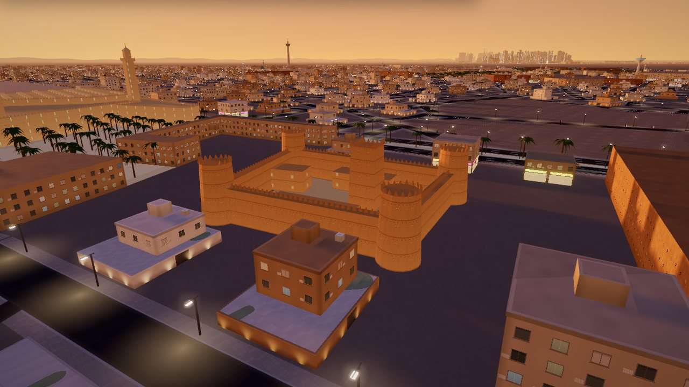 | 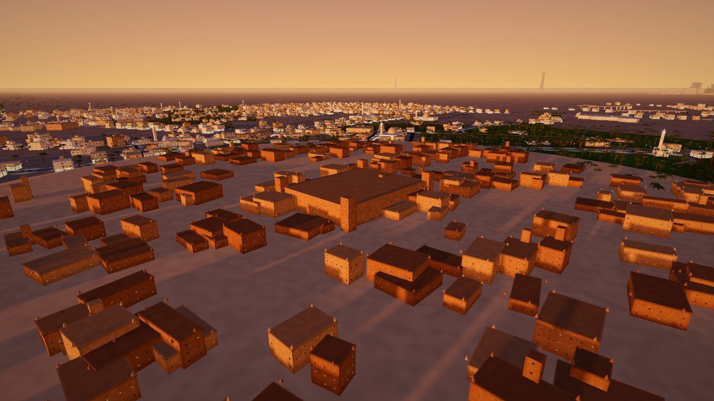 |
| **Masmak Fortress**, where the story of modern Riyadh began · قصر المصمك | **At-Turaif, Diriyah** at sunset · حي الطريف في الدرعية |
| 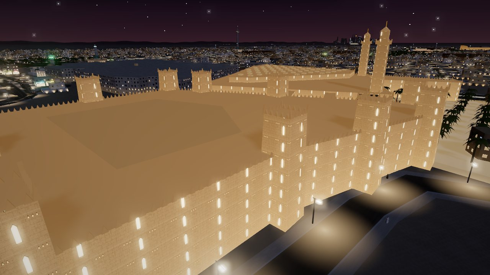 | 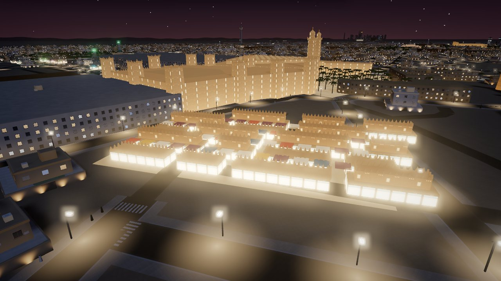 |
| **Qasr Al-Hokm** and the Grand Mosque at night · قصر الحكم وجامع الإمام تركي ليلاً | **Souq Al-Zal** after dark · سوق الزل ليلاً |
| 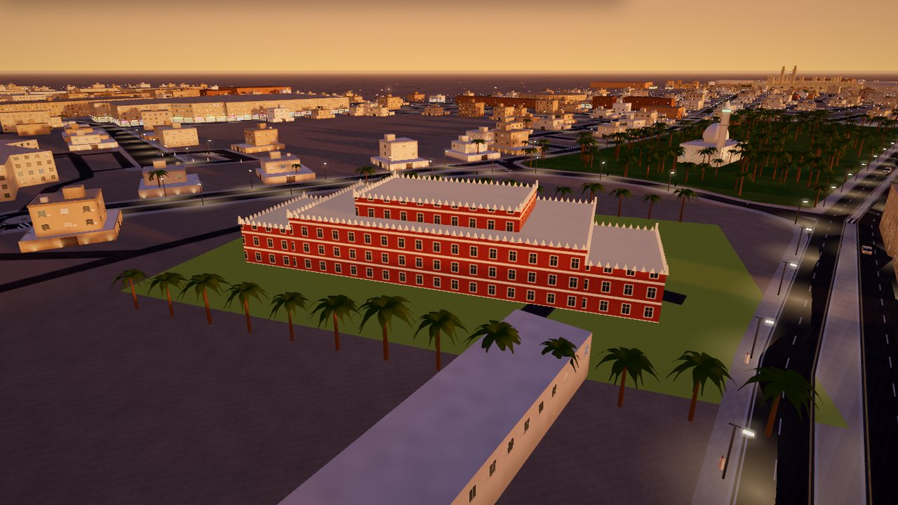 | 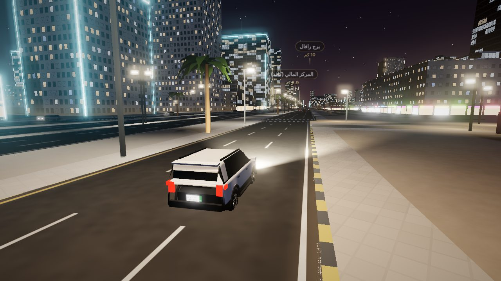 |
| **The Red Palace** in its garden · القصر الأحمر | **King Fahd Road at night**, with street and building lights · طريق الملك فهد ليلاً |
| 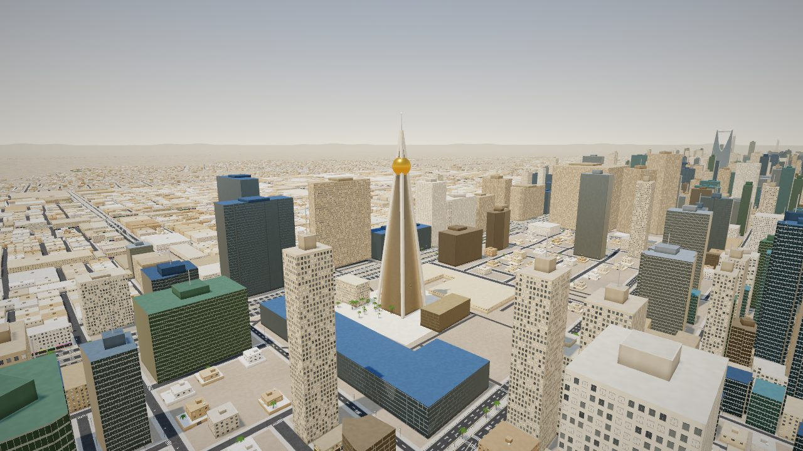 | 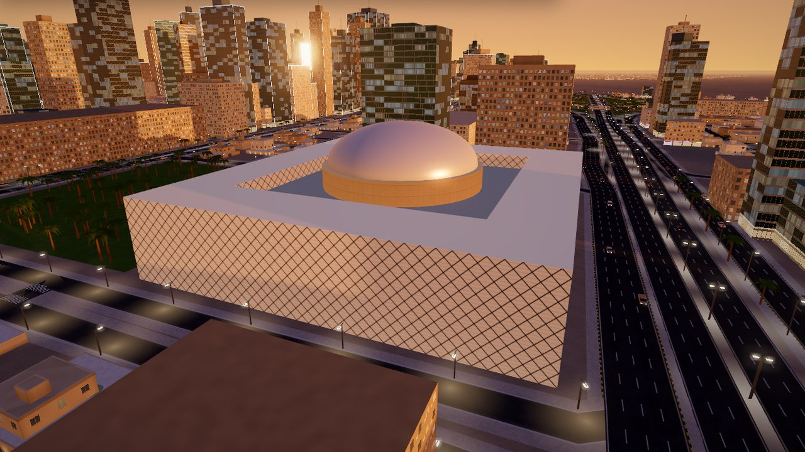 |
| **Al Faisaliah** and Kingdom Centre at noon · برج الفيصلية وبرج المملكة ظهراً | **King Fahd National Library** · مكتبة الملك فهد الوطنية |

**On a phone · على الجوال:** the guided tour with narration, the guide with shopping and food, the tourist panel with prayer times, and road guidance with the driving pedals.

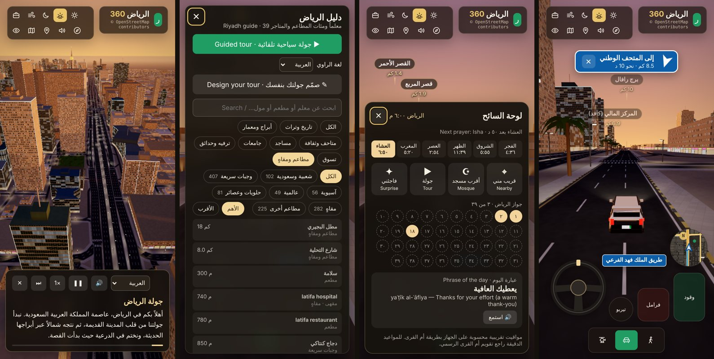

**Design your own tour · صمّم جولتك:** read about a landmark before adding it, the route ordered by road with each leg's
direction and length, and the food list sorted into traditional, fast food, Asian and more.

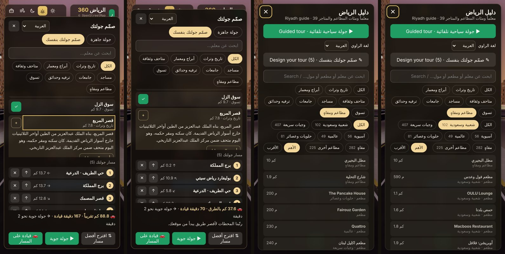

**In a tunnel · داخل النفق:** the Abi Bakr Al Siddiq tunnel at dusk and at night, with the steering wheel turned a quarter right.

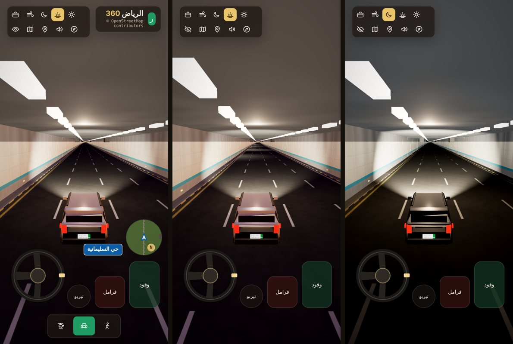

## Controls

| | Keyboard | Phone |
|---|---|---|
| Move | WASD / arrows | left stick; a steering wheel while driving |
| Accelerate / brake | W / S | right pedals |
| Boost | Shift | تيربو |
| Jump / climb, descend | Space or E, Q | on-screen buttons |
| Modes | 1 walk · 2 drive · 3 fly | bottom bar |
| Cameras / cockpit | V / C | |
| Map · time of day · hide HUD | M · T · H | top bar |
| Guide · tourist panel · end tour | G · P · Esc | compass · bag |

## Data

Everything comes from OpenStreetMap (© OpenStreetMap contributors, ODbL), extracted with BBBike as a GeoPackage:

```
python3 -I tools/build_osm.py riyadh.gpkg data/   # roads, buildings, land, rail, infill, routing graph
python3 -I tools/build_poi.py riyadh.gpkg data/   # named shops, souqs, restaurants and cafés
for f in data/*.bin; do base64 -w 0 "$f" > "${f%.bin}.b64.txt"; done   # the page loads the base64 text files
```

- 92,656 road ways with names, lanes, one-way, speed limits, and the vertical profile of bridges and tunnels.
- 88,894 building footprints (stations and car parks below ground are left out). Few have heights in OSM, so heights are estimated from type, size and location.
- 412,354 generated villa, shop and apartment plots, placed only along real residential streets on free land.
- A routing graph of 151,614 junctions and 226,991 road pieces. It is loaded only when a route is first asked for.
- 1,284 named places for shopping and food, and 1,249 mosques.
- Kingdom Centre, Al Faisaliah, PIF Tower, Burj Rafal, the Water Tower, the TV Tower, the Ministry of Interior and
  At-Turaif are hand-built models at their OSM positions.
- The old town is hand-built on the real OSM outlines in Najdi style, with mud and limestone walls, triangular vents
  and merlons, floodlit at night: Masmak Fortress, Deera Square, the Imam Turki bin Abdullah Grand Mosque with its two
  minarets and the bridges to Qasr Al-Hokm, Souq Al-Zal, Murabba Palace, the Red Palace, the National Museum and its
  curved wall, and King Fahd National Library in its cube of white fabric diamonds. Diriyah and the Murabba quarter
  are drawn in mud brick.

## Files

- `js/main.js`: renderer, time-of-day presets, cameras, HUD, minimap and atlas, touch controls
- `js/osm.js`: loads the OSM data, spatial grids, nearest-road queries, bridge and tunnel heights
- `js/world.js`: builds the city in 1 km chunks: roads, bridges, tunnels, buildings, land use, infill, lamps, palms
- `js/player.js`: walking, the Land Cruiser model and driving, the helicopter
- `js/cars.js`, `js/traffic.js`: traffic on the real road network
- `js/guide.js`: landmark list, categories and search, shopping and food, routing and guidance
- `js/tour.js`: the guided tour, its narration in six languages, and the narrator
- `js/tourist.js`: the tourist panel and prayer times
- `js/materials.js`: facade shader with night lights, roads, ground, sky, palms
- `js/landmarks.js`, `js/geo.js`, `js/city.js`: hand-built landmarks, coordinates and places, instancing helpers
- `js/najdi.js`: wall textures and the builder for the Najdi buildings (walls, towers, merlons, courtyards)
- `tools/`: the Python scripts that turn the GeoPackage into the files in `data/`

To run it locally, serve the folder with any static server (for example `npx serve .`) and open `index.html`.

## Tests

The tests open the full site in a browser and check what a visitor relies on: map names shown as text and never
run, recovery after failed downloads, routes by car and on foot to every landmark, panels that fit small phone
screens, clear messages when the engine or WebGL2 is missing, Isha in Ramadan, narration after a pause, the sorting
of food and shopping, the best order of a custom tour, steering (an exit at 60 km/h, the touch wheel) and tunnels.
They run on every push (GitHub Actions, `.github/workflows/test.yml`).

```
cd tests && npm install && npx playwright install chromium
node run.mjs                     # all browser tests; ONLY="routes" node run.mjs runs the ones whose name matches
python3 -I test_gpkg.py          # the GeoPackage reader
```

To rebuild the data, install the Python requirements first: `pip install -r tools/requirements.txt`.

## License

The code is under the [MIT License](LICENSE). The map data in `data/` is © OpenStreetMap contributors under the
[Open Database License](https://opendatacommons.org/licenses/odbl/).

## Credits

- Map data © [OpenStreetMap contributors](https://www.openstreetmap.org/copyright), ODbL, extract by [BBBike](https://extract.bbbike.org/).
- Built with [three.js](https://threejs.org/). The idea comes from [mrdoob/slop-newyork](https://github.com/mrdoob/slop-newyork).
- Prayer times use the Umm al-Qura parameters, computed in the browser (Isha 90 minutes after Maghrib, 120 in Ramadan).
